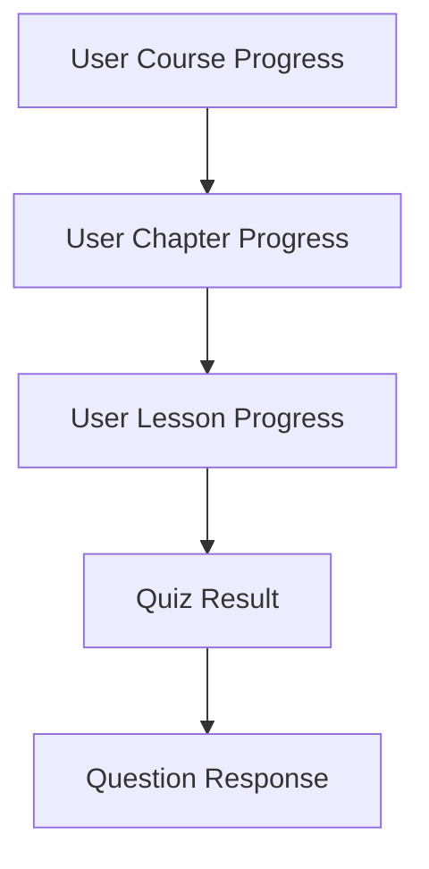

# Feature: Learning Progress Tracking

## 1. Tổng quan

Hệ thống tracking tiến độ học tập 3 cấp (Course → Chapter → Lesson), cung cấp visibility cho cả learner và instructor. Dữ liệu progress là nền tảng cho certification, analytics, và engagement.

---

## 2. Progress Hierarchy

---

## 3. Progress by Course

| # | Yêu cầu | Chi tiết |
|---|---------|---------|
| PC-01 | Course enrollment | Tự động tạo tracking record khi user enroll/mua khoá học |
| PC-02 | Overall progress % | Tính theo % chapters hoàn thành |
| PC-03 | Course status | Not Started → In Progress → Completed |
| PC-04 | Completion date | Timestamp khi hoàn thành 100% |
| PC-05 | Last accessed | Timestamp lần truy cập gần nhất |
| PC-06 | Progress bar | Hiển thị trên course card & detail page |
| PC-07 | Homepage progress | Hiển thị progress bar trên homepage cho "My Courses" |
| PC-08 | Resume learning | Button "Continue Learning" → quay lại lesson cuối |
| PC-09 | Course certificate | Tự động issue certificate khi complete + pass final quiz |

---

## 4. Progress by Chapter

| # | Yêu cầu | Chi tiết |
|---|---------|---------|
| PCH-01 | Chapter progress % | Tính theo % lessons hoàn thành trong chapter |
| PCH-02 | Chapter status | Not Started → In Progress → Completed |
| PCH-03 | Sequential unlock | Tuỳ chọn: phải hoàn thành chapter trước mới mở chapter sau |
| PCH-04 | Chapter completion | Tự động update khi tất cả lessons done |

---

## 5. Progress by Lesson

| # | Yêu cầu | Chi tiết |
|---|---------|---------|
| PL-01 | Lesson completion | Mark as complete (manual button hoặc auto khi xem hết video) |
| PL-02 | Lesson status | Not Started → In Progress → Completed |
| PL-03 | Time spent | Track thời gian user dành cho từng lesson |
| PL-04 | Video progress | Track % video đã xem |
| PL-05 | Quiz completion | Lesson hoàn thành khi pass quiz đính kèm |
| PL-06 | SCORM tracking | Lưu SCORM completion status & score |
| PL-07 | H5P tracking | Lưu H5P interaction results |

---

## 6. "My Courses" Dashboard

| # | Yêu cầu | Chi tiết |
|---|---------|---------|
| MC-01 | Course list | Danh sách khoá học đã enroll với progress bar |
| MC-02 | Filter & sort | Filter: status (all/in-progress/completed), sort: recent/name |
| MC-03 | Quick continue | Button "Continue" để resume từ lesson cuối |
| MC-04 | Course info | Hiển thị: instructor, category, completion %, enrolled date |
| MC-05 | Homepage widget | Block hiển thị top 3-5 khoá học đang học trên homepage |

---

## 7. Instructor Progress View

| # | Yêu cầu | Chi tiết |
|---|---------|---------|
| IP-01 | Student roster | Danh sách students enrolled trong khoá học |
| IP-02 | Individual progress | Xem chi tiết tiến độ từng student |
| IP-03 | Class analytics | Tỷ lệ completion, điểm trung bình, drop-off points |
| IP-04 | Export progress | Export CSV danh sách students + progress |
