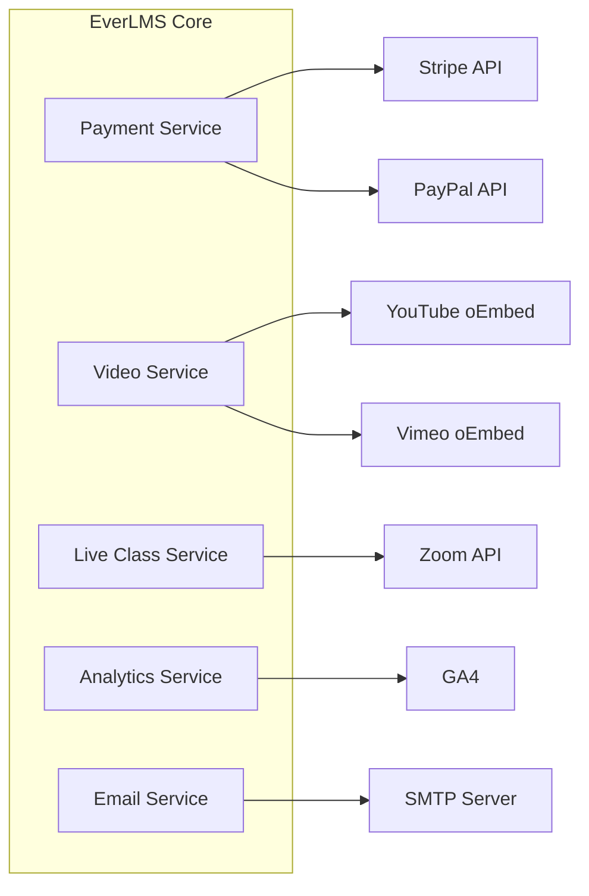

# Feature: Platform Integrations

## 1. Tổng quan

EverLMS tích hợp với các dịch vụ bên ngoài để mở rộng khả năng: payment gateways, video platforms, analytics, Zoom, và email services.

---

## 2. Payment Gateways

| # | Integration | Chi tiết |
|---|-----------|---------|
| PI-01 | **Stripe** | Checkout Sessions, Subscriptions, Webhooks, Refunds |
| PI-02 | **PayPal** | PayPal Checkout, Subscriptions, IPN/Webhooks |
| PI-03 | **Plugin architecture** | Interface-based design cho thêm gateway mới |

---

## 3. Video Platforms

| # | Integration | Chi tiết |
|---|-----------|---------|
| VP-01 | **YouTube** | oEmbed auto-embed, API metadata fetch |
| VP-02 | **Vimeo** | oEmbed auto-embed, privacy-controlled |
| VP-03 | **Generic embed** | Hỗ trợ iframe embed code |

---

## 4. Live Class

| # | Integration | Chi tiết |
|---|-----------|---------|
| ZM-01 | **Zoom** | Create/Join meeting via API, recording links |
| ZM-02 | **Expandable** | Interface cho Google Meet, MS Teams (future) |

---

## 5. Interactive Content

| # | Integration | Chi tiết |
|---|-----------|---------|
| IC-01 | **H5P** | Embed interactive content, score tracking |
| IC-02 | **SCORM** | SCORM 1.2/2004 packages, completion tracking |

---

## 6. Analytics & Marketing

| # | Integration | Chi tiết |
|---|-----------|---------|
| AM-01 | **Google Analytics 4** | Pageviews, events, e-commerce tracking |
| AM-02 | **Google Tag Manager** | Container management |
| AM-03 | **Facebook Pixel** | Conversion tracking (tuỳ chọn) |

---

## 7. Communication

| # | Integration | Chi tiết |
|---|-----------|---------|
| CM-01 | **SMTP / Email** | Transactional emails (Drupal Symfony Mailer) |
| CM-02 | **Webform** | Custom forms cho surveys, contact, feedback |

---

## 8. Multilingual

| # | Integration | Chi tiết |
|---|-----------|---------|
| ML-01 | **Drupal i18n** | Content translation, interface translation |
| ML-02 | **Language detection** | URL prefix hoặc browser language detection |
| ML-03 | **RTL support** | Right-to-left language support |

---

## 9. Integration Architecture

> **Thiết kế Plugin-based**: Mỗi integration là 1 Drupal module riêng, implement chung 1 interface. Dễ dàng enable/disable và thêm integration mới mà không ảnh hưởng core.
