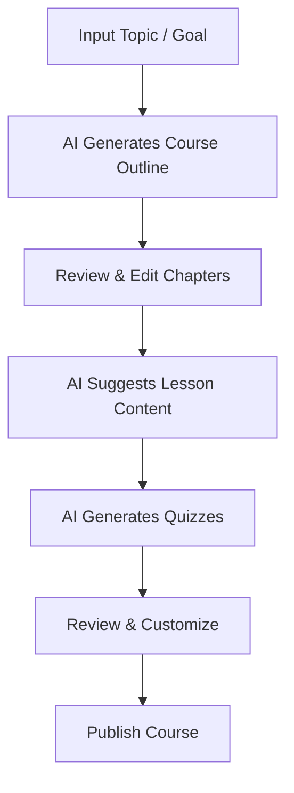
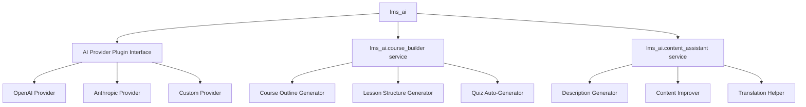

# Feature: AI-Powered Features

## 1. Tổng quan

EverLMS tích hợp AI trực tiếp vào quy trình tạo nội dung, giúp educators và training managers xây dựng khoá học chuyên nghiệp nhanh hơn nhiều lần. Hai tính năng chủ lực: **AI Course Builder** và **AI Content Assistant**.

---

## 2. AI Course Builder

> *Build complete courses in minutes with AI support.*

### 2.1 Core Capabilities
| # | Capability | Chi tiết |
|---|-----------|---------|
| ACB-01 | **Auto-generate course outlines** | AI tạo outline khoá học dựa trên topic hoặc target learner profile |
| ACB-02 | **Suggest lesson structures** | Đề xuất cấu trúc bài học phù hợp với từng skill level (beginner → advanced) |
| ACB-03 | **Smart question generation** | Tự động tạo quizzes & assessments từ nội dung khoá học |
| ACB-04 | **SEO optimization** | Recommend titles, descriptions, keywords tối ưu cho learner engagement |
| ACB-05 | **Format adaptation** | Adapt content cho nhiều định dạng: video lessons, text-based, interactive |
| ACB-06 | **One-click course scaffolding** | Tạo toàn bộ structure (course → chapters → lessons) từ 1 topic input |
| ACB-07 | **Difficulty calibration** | Tự động điều chỉnh độ khó theo target audience |

### 2.2 Workflow


### 2.3 Technical Implementation
| Component | Mô tả |
|-----------|-------|
| **AI Provider** | OpenAI GPT-4 / Claude API (configurable) |
| **Integration** | Custom Drupal service `lms_ai.course_builder` |
| **UI** | Wizard form: Topic → Outline → Content → Quiz → Review |
| **Config** | Admin-configurable: API key, model selection, temperature, token limits |
| **Caching** | Cache AI responses cho same inputs, reduce API costs |
| **Queue** | Batch generation qua Drupal Queue API (cho large courses) |

---

## 3. AI Content Assistant

> *Generate lessons, quizzes, and descriptions instantly.*

### 3.1 Core Capabilities
| # | Capability | Chi tiết |
|---|-----------|---------|
| ACA-01 | **Auto-generate lesson descriptions** | Tạo mô tả bài học từ title hoặc core ideas |
| ACA-02 | **Level-adaptive content** | Nội dung tailored cho từng learner level |
| ACA-03 | **One-click quiz creation** | Tạo quizzes, assignments, assessments từ lesson content |
| ACA-04 | **Language & layout optimization** | Cải thiện ngôn ngữ, cấu trúc, và layout cho readability |
| ACA-05 | **Content summarization** | Tóm tắt nội dung dài thành key points |
| ACA-06 | **Translation assistance** | Hỗ trợ dịch content sang ngôn ngữ khác |
| ACA-07 | **SEO meta generation** | Auto-generate meta title, description, keywords |

### 3.2 Integration Points
| Context | AI Action | Trigger |
|---------|-----------|---------|
| Course creation form | Generate description, outline | Button "✨ AI Generate" |
| Lesson creation form | Generate content, summarize | Button "✨ AI Assist" |
| Quiz creation | Generate questions from content | Button "✨ Auto Questions" |
| CKEditor integration | Improve text, simplify, expand | Toolbar button "AI" |
| Bulk content | Generate multiple lessons at once | Batch UI |

### 3.3 UI Mockup Description
```
┌─────────────────────────────────────────────────┐
│ Create Lesson                                    │
│                                                  │
│ Title: [Introduction to PHP____________]         │
│                                                  │
│ [✨ AI Generate Content]  [✨ AI Generate Quiz]  │
│                                                  │
│ ┌──────────────────────────────────────────────┐ │
│ │ AI is generating content...                  │ │
│ │ ████████████░░░░░░ 65%                       │ │
│ └──────────────────────────────────────────────┘ │
│                                                  │
│ Content: [Rich text editor with AI-generated...] │
│                                                  │
│ [Save Draft]  [Preview]  [Publish]               │
└─────────────────────────────────────────────────┘
```

---

## 4. AI Configuration (Admin)

| # | Setting | Chi tiết |
|---|---------|---------|
| AC-01 | AI Provider | Chọn OpenAI / Anthropic / Custom endpoint |
| AC-02 | API Key | Lưu encrypted trong Drupal config |
| AC-03 | Model selection | GPT-4o / Claude 3.5 / custom |
| AC-04 | Temperature | Creativity level (0.0 - 1.0) |
| AC-05 | Max tokens | Giới hạn output length |
| AC-06 | Default language | Ngôn ngữ mặc định cho AI output |
| AC-07 | Usage tracking | Log AI usage cho billing monitoring |
| AC-08 | Rate limiting | Giới hạn requests per user/day |

---

## 5. Module Architecture


