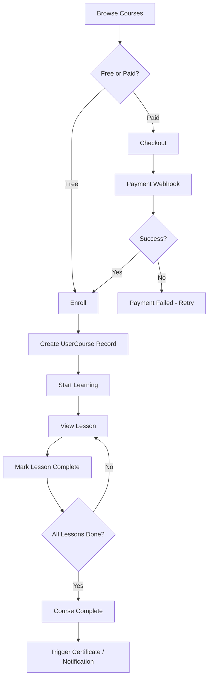

# WF-001 — Enrollment & Learning

**ID:** WF-001
**Trigger:** User truy cập course detail và chọn enroll hoặc mua khóa học
**Actors:** Student, System, Payment Gateway
**Preconditions:** User đã đăng nhập. Course tồn tại và ở trạng thái published.
**Related Features:** F-001 (Course Management), F-004 (Commerce & Orders), F-003 (Learning Progress)
**Related Entities:** Course, Chapter, Lesson, Order, UserCourse, LessonProgress

---

## Happy Path

| Step | Actor | Action | System Response | Feature |
|------|-------|--------|----------------|---------|
| 1 | Student | Browse catalog, vào course detail | Hiển thị curriculum + trạng thái lock/unlock từng lesson | F-001 |
| 2 | Student | Chọn enroll (free) hoặc mua (paid) | Free → tạo UserCourse record; Paid → redirect checkout | F-004 |
| 3 | System | Xác nhận thanh toán qua webhook | Cấp quyền học, tạo UserCourse progress record | F-003 |
| 4 | Student | Bắt đầu học lesson đầu tiên | Render lesson content theo loại (video/text/H5P/SCORM/Zoom) | F-001 |
| 5 | Student | Hoàn thành lesson | Gọi mark-complete, cập nhật LessonProgress | F-003 |
| 6 | System | Progress cascade | Tính lại % chapter và % course tự động | F-003 |
| 7 | System | Kiểm tra completion | Trigger certificate issuance và notification nếu đủ điều kiện | F-005 |

## Error Paths

| Step | Condition | System Response | Recovery |
|------|-----------|----------------|----------|
| 2a | Thanh toán thất bại | Không cấp quyền, order ở pending | Student retry payment |
| 3a | Webhook signature không hợp lệ | Từ chối, log security event | Alert admin |
| 3b | Duplicate webhook | Idempotency key match, bỏ qua | Không hành động |
| 4a | Membership hết hạn | Lesson protected bị khóa | Student renew membership |
| 5a | Concurrent mark-complete | Lock/transaction ngăn duplicate progress | Race condition mitigated |

## Business Rules

- **Free course**: enroll không cần thanh toán — tạo ngay UserCourse record.
- **Membership course**: kiểm tra membership status trước khi cấp access.
- **Continue URL**: trỏ đến lesson tiếp theo chưa hoàn thành (theo thứ tự chapter → lesson).
- **Lesson completion logic**: Video = 90% watched; Text = manual mark; Quiz = passed.
- Progress cascade: lesson complete → update chapterProgress.percent → update UserCourse.percent.

## Process Flow (Mermaid)

## Postconditions

- UserCourse record tồn tại với `status=active`.
- LessonProgress records tạo theo tiến độ học.
- Certificate issued nếu đủ điều kiện.

## Related Docs

- [WF-004 — Checkout & Order](./WF-004-order-management.md)
- [WF-003 — Certificate Issuance](./WF-003-certificate-issuance.md)
- B03 Feature: [F-001 Course Management](../B03-features/01-course-management.md)
- B03 Feature: [F-003 Learning Progress](../B03-features/03-learning-progress.md)
