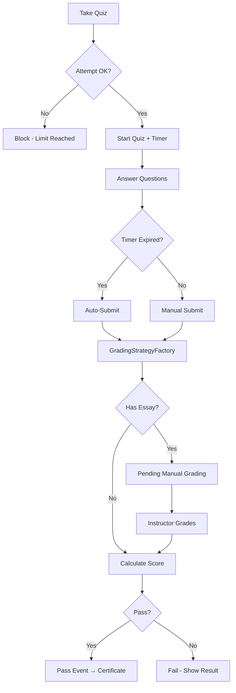

# WF-002 — Quiz Submit & Grading

**ID:** WF-002
**Trigger:** Student bắt đầu làm quiz và nhấn Submit
**Actors:** Student, Instructor (cho essay grading), System
**Preconditions:** Student đã enrolled. Quiz tồn tại, attempt limit chưa bị vượt, prerequisites (nếu có) đã đáp ứng.
**Related Features:** F-002 (Assessment & Grading), F-003 (Learning Progress)
**Related Entities:** Quiz, Question, QuizResult, QuestionResponse, LessonProgress

---

## Happy Path

| Step | Actor | Action | System Response |
|------|-------|--------|----------------|
| 1 | Student | Click "Take Quiz" | Kiểm tra enrollment + attempt limit + prerequisites |
| 2 | System | Khởi tạo quiz session | Render quiz form với timer nếu time_limit cấu hình |
| 3 | Student | Trả lời từng câu hỏi | Client-side AJAX auto-save tiến trình |
| 4 | Student | Submit quiz (hoặc timer hết) | GradingStrategyFactory xử lý từng question type |
| 5 | System | Lưu QuizResult + QuestionResponses | Tính score, so sánh với passing_threshold |
| 6 | System | Dispatch event pass/fail | Trigger certificate (nếu pass) + notification |
| 7 | System | Cập nhật LessonProgress | Cascade lên chapter và course progress |

## Error Paths

| Step | Condition | System Response | Recovery |
|------|-----------|----------------|----------|
| 1a | Attempt limit reached | Block, hiển thị thông báo | Không retry nếu max đã đạt |
| 1b | Prerequisites not met | Redirect với message | Student hoàn thành prerequisite |
| 3a | Timer hết giờ | Auto-submit câu đã trả lời | Hiển thị kết quả |
| 4a | Essay question(s) present | Mark `pending_manual_grading` | Instructor grading route |
| 5a | Hệ thống lỗi khi lưu | Rollback, báo lỗi | Student thử lại |

## Question Types & Grading

| Type | Auto-grade | Strategy |
|------|-----------|---------|
| Multiple Choice (MC) | Yes | Partial credit or full credit |
| Single Choice (SC) | Yes | Full credit only |
| True/False (TF) | Yes | Binary |
| Fill in the Blank | Yes | Case-insensitive exact match |
| Short Answer | Yes | Keyword matching |
| Matching | Yes | Per-pair scoring |
| Ordering | Yes | Position comparison |
| Essay | No | Queue for Instructor manual review |

## Business Rules

- `passing_threshold` cấu hình per-quiz (0–100%).
- `max_attempts`: 0 = unlimited; N = chặn sau N lần.
- Timer auto-submit: nếu `time_limit > 0` và thời gian hết.
- Essay grading: điểm cuối cùng chờ instructor, QuizResult.status = `pending`.
- Sau khi instructor grade essay, QuizResult.status cập nhật và events được dispatch lại.

## Process Flow (Mermaid)

## Postconditions

- QuizResult persisted với score, status (passed/failed/pending).
- QuestionResponse records cho từng câu trả lời.
- Nếu pass: certificate triggered, progress updated.

## Related Docs

- [WF-003 — Certificate Issuance](./WF-003-certificate-issuance.md)
- B03 Feature: [F-002 Assessment System](../B03-features/02-assessment-system.md)
- ADR: GradingStrategyFactory pattern
