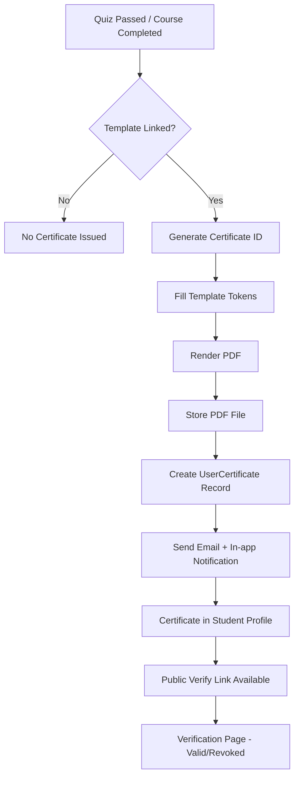

# WF-003 — Certificate Issuance

**ID:** WF-003
**Trigger:** Event `quiz_passed` hoặc `course_completed` được dispatch
**Actors:** System, Student
**Preconditions:** Quiz passed hoặc course completion reached. CertificateTemplate được liên kết với quiz/course.
**Related Features:** F-005 (Certification & Badges)
**Related Entities:** UserCertificate, CertificateTemplate, User, Course/Quiz

---

## Happy Path

| Step | Actor | Action | System Response |
|------|-------|--------|----------------|
| 1 | System | Nhận event completion hoặc quiz pass | Kiểm tra CertificateTemplate có được gắn không |
| 2 | System | Render PDF certificate | Fill template tokens (student name, course, date, score) |
| 3 | System | Lưu file PDF | Store trong file system / managed files |
| 4 | System | Tạo UserCertificate record | Generate unique certificate ID + verify link |
| 5 | System | Gửi notification | Email đính kèm PDF + in-app notification |
| 6 | Student | Truy cập profile | Xem danh sách certificates, download PDF |
| 7 | Student | Chia sẻ verify link | Public page xác nhận certificate hợp lệ |

## Error Paths

| Step | Condition | System Response | Recovery |
|------|-----------|----------------|----------|
| 1a | Không có CertificateTemplate | Bỏ qua issuance | Log, không báo lỗi cho student |
| 2a | PDF render lỗi | Log lỗi, retry job | Background job retry |
| 3a | File storage lỗi | Rollback UserCertificate record | Alert admin |
| 7a | Certificate bị revoke | Verify page trả "revoked" status | Admin action |

## Process Flow (Mermaid)

## Business Rules

- Mỗi UserCertificate có UUID verify token duy nhất.
- Verify endpoint là public (không cần đăng nhập).
- Admin có thể revoke certificate — verify endpoint trả `status=revoked`.
- Certificate PDF template được cấu hình per-course hoặc per-quiz.
- Duplicate prevention: nếu đã có UserCertificate cho cùng student+course, không tạo thêm.

## Postconditions

- UserCertificate record với `status=issued`.
- PDF stored trong managed files.
- Student nhận email + in-app notification.
- Public verify link hoạt động.

## Related Docs

- [WF-001 — Enrollment & Learning](./WF-001-enrollment-learning.md)
- [WF-002 — Quiz Submit & Grading](./WF-002-quiz-grading.md)
- B03 Feature: [F-005 Certification & Badges](../B03-features/06-certification-badges.md)
