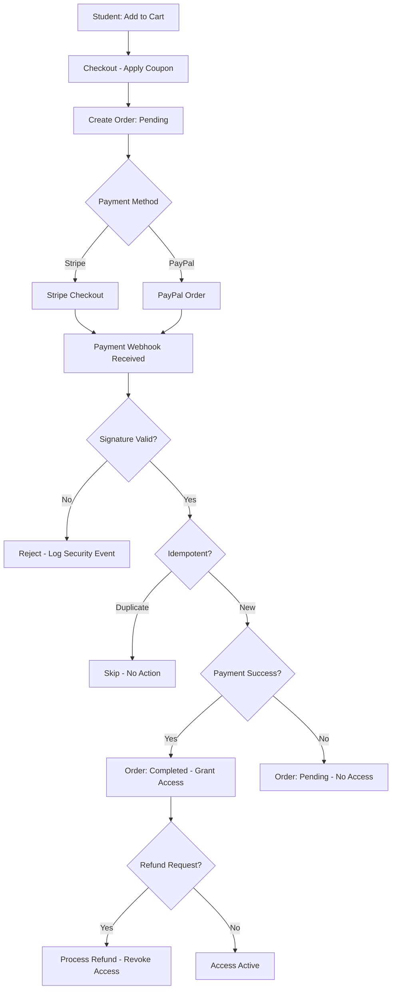

# WF-004 — Checkout & Order Lifecycle

**ID:** WF-004
**Trigger:** Student chọn mua khóa học, bundle, hoặc membership plan
**Actors:** Student, System, Payment Gateway (Stripe/PayPal)
**Preconditions:** Student đã đăng nhập. Items hợp lệ, còn available.
**Related Features:** F-004 (Commerce & Orders)
**Related Entities:** Order, OrderItem, Coupon, Course, MembershipPlan, User

---

## Happy Path

| Step | Actor | Action | System Response |
|------|-------|--------|----------------|
| 1 | Student | Vào checkout | Hiển thị order summary, ô nhập coupon |
| 2 | System | Tạo order pending | Validate items, apply coupon nếu có, tính total |
| 3 | Student | Chọn payment method | Redirect đến Stripe Checkout hoặc PayPal |
| 4 | Gateway | Xử lý thanh toán | Trả về callback + webhook event |
| 5 | System | Verify webhook signature | Kiểm tra idempotency key |
| 6 | System | Cập nhật order status → completed | Grant access: enroll / activate membership |
| 7 | System | Gửi confirmation | Email xác nhận đơn hàng + access granted |

## Error Paths

| Step | Condition | System Response | Recovery |
|------|-----------|----------------|----------|
| 2a | Coupon không hợp lệ | Báo lỗi inline | Student nhập code khác |
| 4a | Payment cancelled | Order stays pending | Student retry |
| 4b | Payment failed | Order stays pending, log | Student retry hoặc dùng method khác |
| 5a | Webhook signature invalid | Reject, log security event | Alert admin |
| 5b | Duplicate webhook | Idempotency key match, skip | Không hành động thêm |
| 6a | Grant access thất bại | Rollback, alert admin | Manual intervention |

## Order State Machine

| State | Transitions |
|-------|------------|
| `pending` | → `paid` (payment success), → `cancelled` (timeout/user cancel) |
| `paid` | → `completed` (access granted), → `refunded` |
| `completed` | → `refunded` (refund request) |
| `cancelled` | Terminal |
| `refunded` | Terminal — access revoked |

## Process Flow (Mermaid)

## Business Rules

- Idempotency key: sử dụng `order_id` để dedup webhook events.
- Coupon validation: code, expiry, usage limit, per-user limit, min order, applicable items.
- Access grant: tạo UserCourse record (course) hoặc activate Membership (plan).
- Refund: revoke enrollment / deactivate membership.
- Manual order: admin có thể tạo order và đánh dấu paid thủ công.

## Postconditions

- Order ở trạng thái `completed` với payment reference.
- Access granted: UserCourse record hoặc Membership activated.
- Student nhận email confirmation.

## Related Docs

- [WF-001 — Enrollment & Learning](./WF-001-enrollment-learning.md)
- [WF-005 — Membership Lifecycle](./WF-005-membership-subscription.md)
- [WF-009 — Coupon Flow](./WF-009-coupon-flow.md)
- B03 Feature: [F-004 Order & Membership](../B03-features/04-order-membership.md)
- INT: [Stripe](../B06-integration-requirements/INT-001-stripe.md), [PayPal](../B06-integration-requirements/INT-002-paypal.md)
