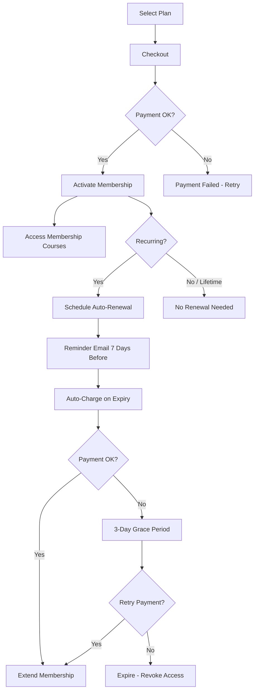

# WF-005 — Membership Lifecycle

**ID:** WF-005
**Trigger:** Student mua membership plan hoặc membership scheduled job chạy
**Actors:** Student, System, Scheduler (cron), Payment Gateway
**Preconditions:** Student đã đăng nhập. MembershipPlan tồn tại và available.
**Related Features:** F-004 (Commerce & Orders)
**Related Entities:** Membership, MembershipPlan, Order, User, Course

---

## Happy Path — Purchase & Activate

| Step | Actor | Action | System Response |
|------|-------|--------|----------------|
| 1 | Student | Xem pricing page, chọn plan | Hiển thị benefits + pricing |
| 2 | Student | Checkout membership | Tạo order, process payment |
| 3 | System | Xác nhận thanh toán | Activate Membership: status=active, set start/end dates |
| 4 | System | Grant course access | Cho phép access tất cả membership-only courses |
| 5 | System | Gửi confirmation email | Email xác nhận với ngày hết hạn |

## Happy Path — Renewal (Recurring)

| Step | Actor | Action | System Response |
|------|-------|--------|----------------|
| 1 | Scheduler | 7 ngày trước expiry | Gửi reminder email |
| 2 | Scheduler | Đến ngày expiry | Auto-charge (nếu recurring) |
| 3 | System | Thanh toán thành công | Extend membership dates |
| 4 | System | Thanh toán thất bại | Vào 3-day grace period |
| 5 | System | Hết grace period, không renew | Expire membership, revoke access |

## Membership States

| State | Trigger | Access |
|-------|---------|--------|
| `trial` | Plan có trial_days > 0 | Full access trong trial period |
| `active` | Payment success | Full access đến end_date |
| `grace` | Payment fail gần expiry | Tiếp tục access trong grace period |
| `expired` | End date passed, không renew | Access revoked |
| `cancelled` | User cancels | Access đến end_date, không auto-renew |

## Process Flow (Mermaid)

## Business Rules

- Membership courses: lesson access check membership status real-time.
- Trial period: nếu `trial_days > 0`, tạo membership với status=trial.
- Lifetime plan: không có end_date, không tự expire.
- Cancellation: access đến cuối billing period, status=cancelled.
- Nếu membership hết hạn trong lúc đang học: lesson protected sẽ lock ngay.

## Postconditions

- Membership record với status và dates chính xác.
- UserCourse access reflect membership status.
- Email notifications sent tại trigger points.

## Related Docs

- [WF-004 — Order Management](./WF-004-order-management.md)
- B03 Feature: [F-004 Order & Membership](../B03-features/04-order-membership.md)
- INT: [Stripe](../B06-integration-requirements/INT-001-stripe.md)
