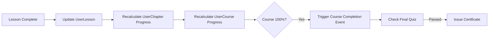

# Progress Tracking Entities

> 3-level progress: Course → Chapter → Lesson. Tự động tính progress cascade.

---

## User Course (`lms_user_course`)

| Field | Type | Mô tả |
|-------|------|-------|
| `field_user` | entity_reference (user) | User |
| `field_course` | entity_reference | Course |
| `field_progress` | decimal | Progress (0-100%) |
| `field_status` | list_string | `not_started` / `in_progress` / `completed` |
| `field_enrolled_date` | timestamp | Ngày enroll |
| `field_completed_date` | timestamp | Ngày hoàn thành |
| `field_last_accessed` | timestamp | Lần truy cập cuối |
| `field_enrollment_source` | list_string | `purchase` / `membership` / `manual` / `free` |

### Business Rules
- Tạo khi user enroll (purchase, membership grant, admin manual)
- `field_progress` = AVG(all chapter progresses)
- Khi `field_progress = 100%` → auto set `field_status = completed` + `field_completed_date`

---

## User Chapter (`lms_user_chapter`)

| Field | Type | Mô tả |
|-------|------|-------|
| `field_user` | entity_reference (user) | User |
| `field_chapter` | entity_reference | Chapter |
| `field_progress` | decimal | Progress (0-100%) |
| `field_status` | list_string | `not_started` / `in_progress` / `completed` |

### Business Rules
- Tạo khi user truy cập lesson đầu tiên trong chapter
- `field_progress` = (completed_lessons / total_lessons) × 100
- Khi all lessons completed → `field_status = completed`
- Cascade update parent UserCourse progress

---

## User Lesson (`lms_user_lesson`)

| Field | Type | Mô tả |
|-------|------|-------|
| `field_user` | entity_reference (user) | User |
| `field_lesson` | entity_reference | Lesson |
| `field_status` | list_string | `not_started` / `in_progress` / `completed` |
| `field_time_spent` | integer | Thời gian đã học (seconds) |
| `field_video_progress` | decimal | % video đã xem (video lessons only) |
| `field_completed_date` | timestamp | Ngày hoàn thành |

### Business Rules
- **Video lesson**: complete khi `field_video_progress >= 90%`
- **Text lesson**: complete khi user click "Mark as Complete"
- **Quiz lesson**: complete khi quiz passed
- **H5P lesson**: complete khi H5P reports completion
- **SCORM lesson**: complete khi SCORM reports `completed`/`passed`
- **Zoom lesson**: complete khi attendance confirmed
- Cascade update parent UserChapter + UserCourse progress

---

## Progress Calculation Flow

