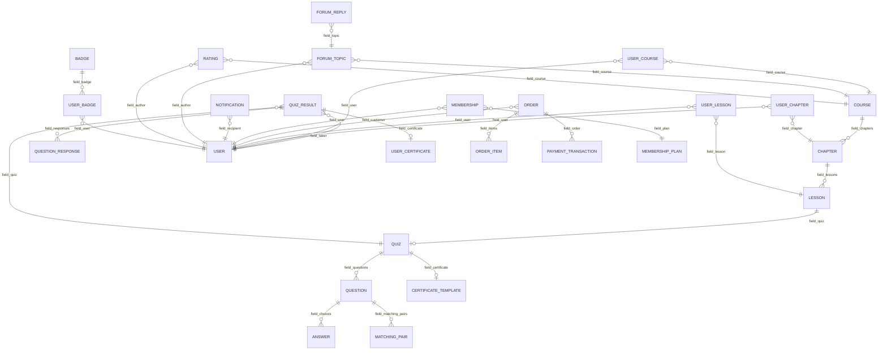

# EverLMS — Data Model Overview

> Tổng quan entity architecture. Chi tiết field definitions trong từng file riêng.

## Entity Relationship Diagram

## Entity Groups

| # | File | Entities | Count |
|---|------|----------|-------|
| 01 | [Content Entities](./01-content-entities.md) | Course, Chapter, Lesson | 3 |
| 02 | [Assessment Entities](./02-assessment-entities.md) | Quiz, Question (8 bundles), Answer, MatchingPair, QuizResult, QuestionResponse | 6 |
| 03 | [Progress Entities](./03-progress-entities.md) | UserCourse, UserChapter, UserLesson | 3 |
| 04 | [Commerce Entities](./04-commerce-entities.md) | Order, OrderItem, Coupon, MembershipPlan, UserMembership, Wishlist, Bundle | 7 |
| 05 | [Certificate Entities](./05-certificate-entities.md) | CertificateTemplate, UserCertificate | 2 |
| 06 | [Taxonomies](./06-taxonomies.md) | 9 taxonomy vocabularies | 9 |
| 07 | [Communication Entities](./07-communication-entities.md) | Notification, ForumTopic, ForumReply, Rating, Comment, FAQ, StudentNote | 7 |
| 08 | [Gamification Entities](./08-gamification-entities.md) | Badge, UserBadge, PaymentTransaction | 3 |
| — | **Total** | — | **40** |
