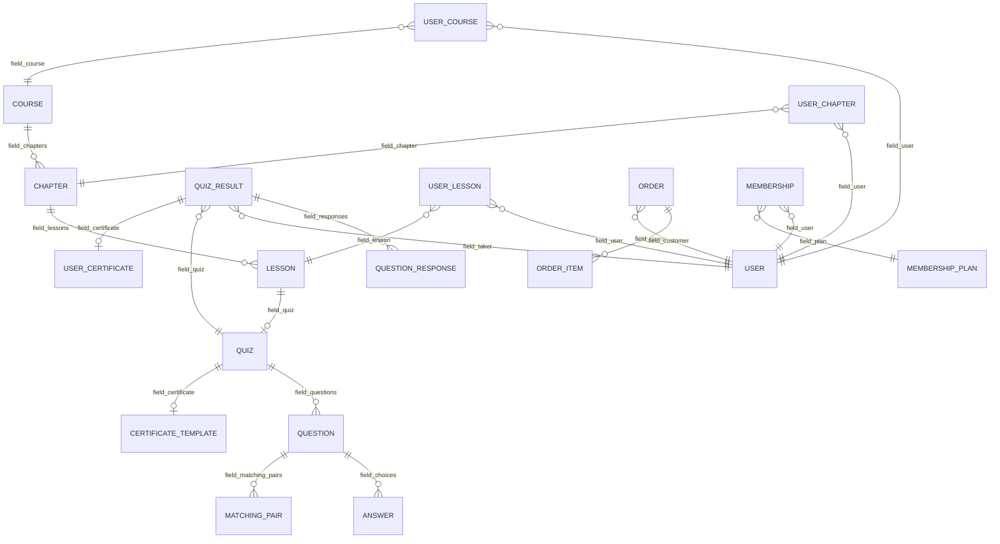

# EverLMS — Data Model & Entities

## 1. Entity Hierarchy

---

## 2. Core Content Entities

### 2.1 Course (`lms_course`)
| Field | Type | Mô tả |
|-------|------|-------|
| `name` | string | Tên khoá học |
| `field_description` | text_long | Mô tả chi tiết |
| `field_thumbnail` | image | Ảnh đại diện |
| `field_banner` | image | Ảnh banner |
| `field_chapters` | entity_reference (multi) | Danh sách chapters |
| `field_category` | entity_reference (taxonomy) | Category |
| `field_tags` | entity_reference (taxonomy, multi) | Tags |
| `field_level` | entity_reference (taxonomy) | Beginner/Intermediate/Advanced |
| `field_language` | entity_reference (taxonomy) | Ngôn ngữ |
| `field_instructor` | entity_reference (user, multi) | Giảng viên |
| `field_price` | decimal | Giá (0 = free) |
| `field_price_type` | list_string | free / paid / membership |
| `field_duration` | integer | Tổng thời lượng (minutes) |
| `field_prerequisites` | entity_reference (self, multi) | Khoá học prerequisite |
| `field_bestseller` | boolean | Cờ bestseller |
| `field_featured` | boolean | Hiển thị featured |
| `field_quizzes` | entity_reference (multi) | Final quizzes |
| `status` | boolean | Published/Draft |

### 2.2 Chapter (`lms_chapter`)
| Field | Type | Mô tả |
|-------|------|-------|
| `name` | string | Tên chương |
| `field_description` | text_long | Mô tả |
| `field_lessons` | entity_reference (multi) | Danh sách lessons |
| `field_prerequisites` | entity_reference (self, multi) | Chapter prerequisites |
| `weight` | integer | Thứ tự sắp xếp |
| `status` | boolean | Published/Draft |

### 2.3 Lesson (`lms_lesson`)
| Field | Type | Mô tả |
|-------|------|-------|
| `name` | string | Tên bài học |
| `field_content` | text_long | Nội dung rich text |
| `field_type` | list_string | video / text / quiz / h5p / scorm / mixed |
| `field_video_url` | string | YouTube/Vimeo URL |
| `field_video_embed` | text_long | Custom embed code |
| `field_h5p_content` | entity_reference | H5P content |
| `field_scorm_package` | file | SCORM .zip |
| `field_quiz` | entity_reference | Quiz gắn lesson |
| `field_attachments` | file (multi) | Tài liệu đính kèm |
| `field_duration` | integer | Thời lượng (minutes) |
| `field_free_preview` | boolean | Cho phép xem trước |
| `field_prerequisites` | entity_reference (self, multi) | Lesson prerequisites |
| `weight` | integer | Thứ tự sắp xếp |
| `status` | boolean | Published/Draft |

---

## 3. Assessment Entities

### 3.1 Quiz (`lms_quiz`)
| Field | Type | Mô tả |
|-------|------|-------|
| `name` | string | Tên quiz |
| `field_body` | text_long | Instructions |
| `field_questions` | entity_reference (multi) | Danh sách câu hỏi |
| `field_threshold` | integer | Điểm pass (%) |
| `field_time_limit` | integer | Giới hạn thời gian (minutes) |
| `field_certificate` | entity_reference | Certificate template |
| `field_display_right_answer` | boolean | Hiển thị đáp án đúng |
| `field_form_style` | list_string | one_page / question_step |
| `field_difficulty` | entity_reference (taxonomy) | Độ khó |
| `field_question_count` | integer | Số câu rút ngẫu nhiên |
| `field_take_quiz_number` | integer | Giới hạn số lần thi |
| `field_prerequisite_quizzes` | entity_reference (multi) | Quiz prerequisite |

### 3.2 Question (`lms_question`) — 8 bundles
| Bundle | Fields đặc thù |
|--------|---------------|
| `multiple_choice` | `field_choices` (entity_ref → lms_answer) |
| `single_choice` | `field_choices` (entity_ref → lms_answer) |
| `true_false` | `field_correct_answer` (boolean) |
| `fill_blank` | `field_correct_answers`, `field_wrong_answers`, `field_case_sensitive` |
| `short_answer` | `field_correct_answers`, `field_keywords`, `field_match_type`, `field_case_sensitive` |
| `matching` | `field_matching_pairs` (entity_ref → lms_matching_pair), `field_ui_style` |
| `ordering` | `field_ordered_items` (string multi) |
| `essay` | `field_min_words`, `field_max_words`, `field_rubric` |

### 3.3 Answer (`lms_answer`)
| Field | Type | Mô tả |
|-------|------|-------|
| `name` | string | Label |
| `field_body` | text_long | Nội dung |
| `field_correct` | boolean | Đáp án đúng |

### 3.4 Matching Pair (`lms_matching_pair`)
| Field | Type | Mô tả |
|-------|------|-------|
| `field_left_item` | string | Cột trái |
| `field_right_item` | string | Cột phải (đáp án đúng) |
| `weight` | integer | Thứ tự |

### 3.5 Quiz Result (`lms_quiz_result`)
| Field | Type | Mô tả |
|-------|------|-------|
| `field_quiz` | entity_reference | Quiz |
| `field_taker` | entity_reference (user) | User |
| `field_score` | decimal | Điểm (%) |
| `field_result` | entity_reference (taxonomy) | Passed / Failed |
| `field_responses` | entity_reference (multi) | Chi tiết trả lời |
| `field_user_certificate` | entity_reference | Certificate cấp |
| `field_start_time` | timestamp | Bắt đầu |
| `field_end_time` | timestamp | Kết thúc |

### 3.6 Question Response (`lms_question_response`)
| Field | Type | Mô tả |
|-------|------|-------|
| `field_question` | entity_reference | Câu hỏi |
| `field_quiz` | entity_reference | Quiz |
| `field_answers` | entity_reference (multi) | Đáp án đã chọn |
| `field_correct` | boolean | Đúng/Sai |
| `field_score` | decimal | Điểm |
| `field_text_answer` | text_long | Trả lời dạng text |
| `field_pending_review` | boolean | Chờ chấm |
| `field_teacher_feedback` | text_long | Feedback |

---

## 4. Progress Tracking Entities

### 4.1 User Course (`lms_user_course`)
| Field | Type | Mô tả |
|-------|------|-------|
| `field_user` | entity_reference (user) | User |
| `field_course` | entity_reference | Course |
| `field_progress` | decimal | Progress (%) |
| `field_status` | list_string | not_started / in_progress / completed |
| `field_enrolled_date` | timestamp | Ngày enroll |
| `field_completed_date` | timestamp | Ngày hoàn thành |
| `field_last_accessed` | timestamp | Lần truy cập cuối |

### 4.2 User Chapter (`lms_user_chapter`)
| Field | Type | Mô tả |
|-------|------|-------|
| `field_user` | entity_reference (user) | User |
| `field_chapter` | entity_reference | Chapter |
| `field_progress` | decimal | Progress (%) |
| `field_status` | list_string | not_started / in_progress / completed |

### 4.3 User Lesson (`lms_user_lesson`)
| Field | Type | Mô tả |
|-------|------|-------|
| `field_user` | entity_reference (user) | User |
| `field_lesson` | entity_reference | Lesson |
| `field_status` | list_string | not_started / in_progress / completed |
| `field_time_spent` | integer | Thời gian đã học (seconds) |
| `field_video_progress` | decimal | % video đã xem |
| `field_completed_date` | timestamp | Ngày hoàn thành |

---

## 5. Commerce Entities

### 5.1 Order (`lms_order`)
| Field | Type | Mô tả |
|-------|------|-------|
| `field_customer` | entity_reference (user) | Khách hàng |
| `field_items` | entity_reference (multi) | Order items |
| `field_total` | decimal | Tổng tiền |
| `field_currency` | string | Đơn vị tiền tệ |
| `field_status` | list_string | pending / paid / completed / refunded / cancelled |
| `field_payment_method` | string | stripe / paypal |
| `field_payment_id` | string | Transaction ID |
| `field_coupon` | entity_reference | Coupon áp dụng |

### 5.2 Order Item (`lms_order_item`)
| Field | Type | Mô tả |
|-------|------|-------|
| `field_course` | entity_reference | Course |
| `field_price` | decimal | Giá |
| `field_quantity` | integer | Số lượng |

### 5.3 Membership Plan (`lms_membership_plan`)
| Field | Type | Mô tả |
|-------|------|-------|
| `name` | string | Tên plan |
| `field_description` | text_long | Mô tả |
| `field_price` | decimal | Giá |
| `field_duration` | list_string | monthly / yearly / lifetime |
| `field_courses` | entity_reference (multi) | Courses trong plan |
| `field_trial_days` | integer | Số ngày dùng thử |

### 5.4 User Membership (`lms_user_membership`)
| Field | Type | Mô tả |
|-------|------|-------|
| `field_user` | entity_reference (user) | User |
| `field_plan` | entity_reference | Membership plan |
| `field_status` | list_string | active / expired / cancelled |
| `field_start_date` | timestamp | Ngày bắt đầu |
| `field_end_date` | timestamp | Ngày hết hạn |
| `field_auto_renew` | boolean | Tự động gia hạn |

---

## 6. Certificate Entities

### 6.1 Certificate Template (`lms_certificate`)
| Field | Type | Mô tả |
|-------|------|-------|
| `name` | string | Tên template |
| `field_background` | image | Ảnh nền |
| `field_orientation` | list_string | portrait / landscape |
| `field_layout` | text_long | Layout config (JSON) |
| `status` | boolean | Active/Inactive |

### 6.2 User Certificate (`lms_user_certificate`)
| Field | Type | Mô tả |
|-------|------|-------|
| `field_certificate` | entity_reference | Template |
| `field_holder` | entity_reference (user) | Người nhận |
| `field_course` | entity_reference | Course |
| `field_quiz_result` | entity_reference | Quiz result |
| `field_certificate_id` | string | Mã chứng chỉ unique |
| `field_pdf_link` | file | PDF file |
| `field_issued_date` | timestamp | Ngày cấp |
| `field_revoked` | boolean | Đã thu hồi |

---

## 7. Taxonomy Vocabularies

| Vocabulary | Mô tả | Ví dụ |
|-----------|-------|-------|
| `course_category` | Phân loại khoá học (hierarchical) | Web Dev, Design, Business |
| `course_level` | Trình độ | Beginner, Intermediate, Advanced |
| `course_language` | Ngôn ngữ giảng dạy | English, Vietnamese, Japanese |
| `course_tags` | Tags tự do | PHP, JavaScript, Marketing |
| `quiz_difficulty` | Độ khó câu hỏi | Easy, Medium, Hard |
| `quiz_results` | Kết quả quiz | Passed, Failed |
| `faq_category` | Phân loại FAQ | General, Payment, Technical |
| `badge_type` | Loại huy hiệu | Completion, Streak, Quiz Master |
