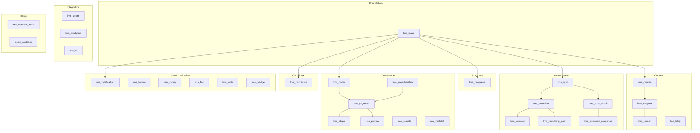

# EverLMS — Module Architecture

> 27 custom modules across 9 layers. Chi tiết từng layer trong file riêng (01–05). Chi tiết từng module trong file per-module.

## Architecture Diagram

---

## Layer Files (Overview)

| # | File | Layer | Modules |
|---|------|-------|---------|
| 01 | [Foundation + Content](./01-foundation-content.md) | Foundation, Content | `lms_base`, `lms_course`, `lms_chapter`, `lms_lesson` |
| 02 | [Assessment](./02-assessment.md) | Assessment | `lms_quiz`, `lms_question` (+ Answer, MatchingPair) |
| 03 | [Progress + Commerce](./03-progress-commerce.md) | Progress, Commerce | `lms_progress`, `lms_order`, `lms_membership`, `lms_payment`, `lms_stripe`, `lms_paypal` |
| 04 | [Certificate + Communication](./04-certificate-communication.md) | Certificate, Communication | `lms_certificate`, `lms_notification`, `lms_forum`, `lms_rating` |
| 05 | [Integration + Theme](./05-integration-theme.md) | Integration, Theme | `lms_zoom`, `lms_analytics`, `lms_ai` |

---

## Per-Module Detail Files

### Foundation Layer

| Module | File | Entities | Routes | Services |
|--------|------|----------|--------|----------|
| `lms_base` | [lms_base.md](./lms_base.md) | 9 taxonomies | none | `lms_base.helper` |

### Content Layer

| Module | File | Entities | Routes | Services |
|--------|------|----------|--------|----------|
| `lms_course` | [lms_course.md](./lms_course.md) | `lms_course` | 30+ routes | `lms_course.breadcrumb` |
| `lms_chapter` | [lms_chapter.md](./lms_chapter.md) | `lms_chapter` | via lms_course | none |
| `lms_lesson` | [lms_lesson.md](./lms_lesson.md) | `lms_lesson` | via lms_course | none |
| `lms_blog` | [lms_blog.md](./lms_blog.md) | `lms_article` | 6 routes | none |

### Assessment Layer

| Module | File | Entities | Routes | Services |
|--------|------|----------|--------|----------|
| `lms_quiz` | [lms_quiz.md](./lms_quiz.md) | Quiz, QuizResult, QuestionResponse | 4 routes | none (Strategy pattern) |
| `lms_question` | [lms_question.md](./lms_question.md) | Question (8 bundles), Answer, MatchingPair | none | none |

### Progress Layer

| Module | File | Entities | Routes | Services |
|--------|------|----------|--------|----------|
| `lms_progress` | [lms_progress.md](./lms_progress.md) | UserCourse, UserLesson | 5 routes | none |

### Commerce Layer

| Module | File | Entities | Routes | Services |
|--------|------|----------|--------|----------|
| `lms_order` | [lms_order.md](./lms_order.md) | Order, OrderItem, Coupon | 3 routes | none |
| `lms_membership` | [lms_membership.md](./lms_membership.md) | MembershipPlan, UserMembership | 9 routes | `lms_membership.manager` |
| `lms_payment` | [lms_payment.md](./lms_payment.md) | PaymentTransaction | 1 route | `plugin.manager.payment_gateway` |
| `lms_stripe` | [lms_stripe.md](./lms_stripe.md) | none | none | none |
| `lms_paypal` | [lms_paypal.md](./lms_paypal.md) | none | none | none |
| `lms_bundle` | [lms_bundle.md](./lms_bundle.md) | CourseBundle | none | none |
| `lms_wishlist` | [lms_wishlist.md](./lms_wishlist.md) | Wishlist | 3 routes | none |

### Certificate Layer

| Module | File | Entities | Routes | Services |
|--------|------|----------|--------|----------|
| `lms_certificate` | [lms_certificate.md](./lms_certificate.md) | CertificateTemplate, UserCertificate | 8 routes | `lms_certificate.generator`, `.manager`, `.event_listener` |

### Communication Layer

| Module | File | Entities | Routes | Services |
|--------|------|----------|--------|----------|
| `lms_notification` | [lms_notification.md](./lms_notification.md) | Notification | 4 routes | `lms_notification.manager` |
| `lms_forum` | [lms_forum.md](./lms_forum.md) | ForumTopic, ForumReply | 6 routes | `lms_forum.route_subscriber` |
| `lms_rating` | [lms_rating.md](./lms_rating.md) | Rating | 2 routes | none |
| `lms_faq` | [lms_faq.md](./lms_faq.md) | FAQ | via lms_course | none |
| `lms_note` | [lms_note.md](./lms_note.md) | Note | 4 routes (API) | none |
| `lms_badge` | [lms_badge.md](./lms_badge.md) | Badge, UserBadge | none | none |

### Integration Layer

| Module | File | Entities | Routes | Services |
|--------|------|----------|--------|----------|
| `lms_ai` | [lms_ai.md](./lms_ai.md) | none | 4 routes | `plugin.manager.lms_ai_provider` + 3 services |
| `lms_analytics` | [lms_analytics.md](./lms_analytics.md) | none | 7 routes | 4 report services |
| `lms_zoom` | [lms_zoom.md](./lms_zoom.md) | none | 3 routes | `lms_zoom.service`, `.meeting_manager`, `.ai_service` |

### Utility Layer

| Module | File | Entities | Routes | Services |
|--------|------|----------|--------|----------|
| `lms_content_tools` | [lms_content_tools.md](./lms_content_tools.md) | none | 3 routes | `lms_content_tools.manager` |
| `open_switcher` | [open_switcher.md](./open_switcher.md) | none | 5 routes | none |

---

## Summary

| Layer | Modules | Entities | Notes |
|-------|---------|----------|-------|
| Foundation | 1 | 9 taxonomies | Zero-dep base |
| Content | 4 | 4 | lms_course = hub module |
| Assessment | 2 | 6 | Strategy pattern grading |
| Progress | 1 | 2–3 | User portal + lesson view |
| Commerce | 7 | 7 | Gateway plugin system |
| Certificate | 1 | 2 | Event-driven issuance |
| Communication | 6 | 6 | Forum, notifications, ratings, faq, note, badge |
| Integration | 3 | 0 | AI, analytics, Zoom |
| Utility | 2 | 0 | Dev tools + impersonation |
| **Total** | **27** | **36+** | |

---

## Module Breakdown Detail

See also: [module-breakdown.md](./module-breakdown.md) for aggregate view.
