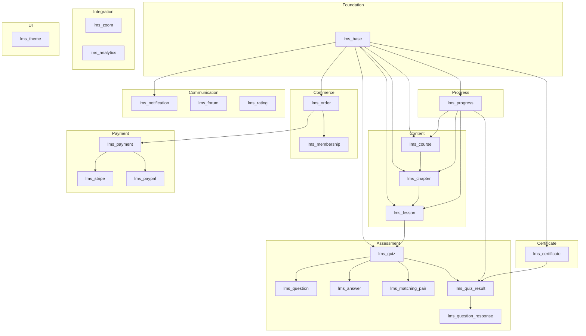

# EverLMS — Module Breakdown

## 1. Module Architecture

---

## 2. Module Details

### Foundation Layer

#### `lms_base` — Core Utilities
| Attribute | Value |
|-----------|-------|
| **Responsibility** | Shared services, taxonomies, base utilities, config |
| **Entities** | None (provides shared services) |
| **Dependencies** | `drupal:system` |
| **Services** | `lms_base.helper`, `lms_base.config` |

---

### Content Layer

#### `lms_course` — Course Management
| Attribute | Value |
|-----------|-------|
| **Responsibility** | Course CRUD, listing, search, categories |
| **Entities** | `lms_course`, `lms_course_type` |
| **Dependencies** | `lms_base` |
| **Services** | `lms_course.manager`, `lms_course.search` |

#### `lms_chapter` — Chapter Management
| Attribute | Value |
|-----------|-------|
| **Responsibility** | Chapter CRUD, ordering within course |
| **Entities** | `lms_chapter`, `lms_chapter_type` |
| **Dependencies** | `lms_base`, `lms_course` |
| **Services** | `lms_chapter.manager` |

#### `lms_lesson` — Lesson Management
| Attribute | Value |
|-----------|-------|
| **Responsibility** | Lesson CRUD, multi-type content, media |
| **Entities** | `lms_lesson`, `lms_lesson_type` |
| **Dependencies** | `lms_base`, `lms_chapter` |
| **Services** | `lms_lesson.manager`, `lms_lesson.media_handler` |

---

### Assessment Layer

#### `lms_quiz` — Quiz Engine
| Attribute | Value |
|-----------|-------|
| **Responsibility** | Quiz CRUD, take quiz form, submission flow |
| **Entities** | `lms_quiz`, `lms_quiz_type` |
| **Dependencies** | `lms_base`, `lms_question`, `lms_answer` |
| **Services** | `lms_quiz.manager`, `lms_quiz.create` |

#### `lms_question` — Question Management
| Attribute | Value |
|-----------|-------|
| **Responsibility** | Question CRUD, polymorphic handlers (8 types) |
| **Entities** | `lms_question`, `lms_question_type` |
| **Dependencies** | `lms_base` |
| **Services** | `lms_question.handler_manager` (Strategy Pattern) |

#### `lms_answer` — Answer Choices
| Attribute | Value |
|-----------|-------|
| **Responsibility** | Answer choice entities |
| **Entities** | `lms_answer`, `lms_answer_type` |
| **Dependencies** | `lms_base` |

#### `lms_matching_pair` — Matching Pairs
| Attribute | Value |
|-----------|-------|
| **Responsibility** | Matching question pair data |
| **Entities** | `lms_matching_pair` |
| **Dependencies** | `lms_base` |

#### `lms_quiz_result` — Quiz Results
| Attribute | Value |
|-----------|-------|
| **Responsibility** | Store quiz attempt outcomes |
| **Entities** | `lms_quiz_result` |
| **Dependencies** | `lms_base`, `lms_quiz` |

#### `lms_question_response` — Granular Responses
| Attribute | Value |
|-----------|-------|
| **Responsibility** | Per-question user response storage |
| **Entities** | `lms_question_response` |
| **Dependencies** | `lms_base`, `lms_question` |

---

### Progress Layer

#### `lms_progress` — Learning Progress
| Attribute | Value |
|-----------|-------|
| **Responsibility** | Track user progress at course/chapter/lesson levels |
| **Entities** | `lms_user_course`, `lms_user_chapter`, `lms_user_lesson` |
| **Dependencies** | `lms_base`, `lms_course`, `lms_chapter`, `lms_lesson`, `lms_quiz_result` |
| **Services** | `lms_progress.course_manager`, `lms_progress.chapter_manager`, `lms_progress.lesson_manager` |

---

### Commerce Layer

#### `lms_order` — Order Management
| Attribute | Value |
|-----------|-------|
| **Responsibility** | Order CRUD, checkout flow, invoicing |
| **Entities** | `lms_order`, `lms_order_item`, `lms_coupon` |
| **Dependencies** | `lms_base`, `lms_payment` |
| **Services** | `lms_order.manager`, `lms_order.checkout` |

#### `lms_membership` — Membership & Subscription
| Attribute | Value |
|-----------|-------|
| **Responsibility** | Membership plans, user subscriptions, auto-renewal |
| **Entities** | `lms_membership_plan`, `lms_user_membership` |
| **Dependencies** | `lms_base`, `lms_payment` |
| **Services** | `lms_membership.manager`, `lms_membership.renewal` |

#### `lms_payment` — Payment Gateway Core
| Attribute | Value |
|-----------|-------|
| **Responsibility** | Payment processing interface, transaction logging |
| **Entities** | `lms_payment_transaction` |
| **Dependencies** | `lms_base` |
| **Services** | `lms_payment.gateway_manager` (Plugin-based) |

#### `lms_stripe` — Stripe Integration
| Attribute | Value |
|-----------|-------|
| **Responsibility** | Stripe Checkout, subscriptions, webhooks |
| **Dependencies** | `lms_payment` |
| **Services** | `lms_stripe.gateway` |

#### `lms_paypal` — PayPal Integration
| Attribute | Value |
|-----------|-------|
| **Responsibility** | PayPal Checkout, webhooks |
| **Dependencies** | `lms_payment` |
| **Services** | `lms_paypal.gateway` |

---

### Certificate Layer

#### `lms_certificate` — Certificate & Badges
| Attribute | Value |
|-----------|-------|
| **Responsibility** | Certificate templates, issuance, PDF generation, badges |
| **Entities** | `lms_certificate`, `lms_user_certificate`, `lms_badge`, `lms_user_badge` |
| **Dependencies** | `lms_base`, `lms_quiz_result` |
| **Services** | `lms_certificate.generator`, `lms_certificate.pdf`, `lms_badge.manager` |

---

### Communication Layer

#### `lms_notification` — Notifications
| Attribute | Value |
|-----------|-------|
| **Responsibility** | In-app + email notifications, preferences |
| **Entities** | `lms_notification` |
| **Dependencies** | `lms_base` |
| **Services** | `lms_notification.manager`, `lms_notification.dispatcher` |

#### `lms_forum` — Forum & Discussion
| Attribute | Value |
|-----------|-------|
| **Responsibility** | Course forums, topics, replies, moderation |
| **Dependencies** | `lms_base`, `lms_course` |
| **Notes** | Có thể leverage Drupal contrib (forum module) hoặc custom |

#### `lms_rating` — Rating & Reviews
| Attribute | Value |
|-----------|-------|
| **Responsibility** | Course ratings, text reviews, FAQ |
| **Dependencies** | `lms_base`, `lms_course` |
| **Services** | `lms_rating.manager` |

---

### Integration Layer

#### `lms_zoom` — Zoom Integration
| Attribute | Value |
|-----------|-------|
| **Responsibility** | Create/manage Zoom meetings, calendar |
| **Dependencies** | `lms_base`, `lms_lesson` |
| **Services** | `lms_zoom.api_client`, `lms_zoom.meeting_manager` |

#### `lms_analytics` — Analytics
| Attribute | Value |
|-----------|-------|
| **Responsibility** | Dashboard KPIs, reports, GA4 integration |
| **Dependencies** | `lms_base` |
| **Services** | `lms_analytics.report_manager`, `lms_analytics.dashboard` |

---

### Theme Layer

#### `lms_theme` — Custom Theme
| Attribute | Value |
|-----------|-------|
| **Base theme** | Custom (Bootstrap 5.3) |
| **Responsibility** | Responsive UI, page templates, SCSS design system |
| **Structure** | `scss/`, `js/`, `templates/`, `images/` |

---

## 3. Module Summary

| Layer | Modules | Entities |
|-------|---------|----------|
| Foundation | 1 | 0 |
| Content | 3 | 3 |
| Assessment | 6 | 6 |
| Progress | 1 | 3 |
| Commerce | 5 | 6 |
| Certificate | 1 | 4 |
| Communication | 3 | 1+ |
| Integration | 2 | 0 |
| Theme | 1 | 0 |
| **Total** | **23** | **23+** |
