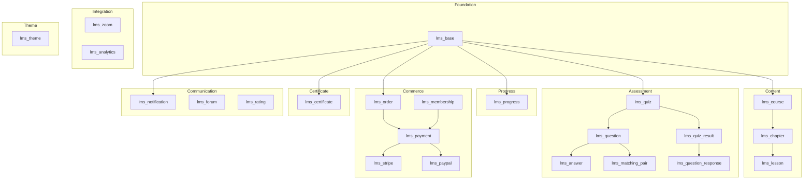

# EverLMS — Module Architecture

> 23 custom modules across 9 layers. Chi tiết từng layer trong file riêng.

## Architecture Diagram

## Layer Index

| # | File | Layer | Modules |
|---|------|-------|---------|
| 01 | [Foundation + Content](./01-foundation-content.md) | Foundation, Content | `lms_base`, `lms_course`, `lms_chapter`, `lms_lesson` |
| 02 | [Assessment](./02-assessment.md) | Assessment | `lms_quiz`, `lms_question`, `lms_answer`, `lms_matching_pair`, `lms_quiz_result`, `lms_question_response` |
| 03 | [Progress + Commerce](./03-progress-commerce.md) | Progress, Commerce | `lms_progress`, `lms_order`, `lms_membership`, `lms_payment`, `lms_stripe`, `lms_paypal` |
| 04 | [Certificate + Communication](./04-certificate-communication.md) | Certificate, Communication | `lms_certificate`, `lms_notification`, `lms_forum`, `lms_rating` |
| 05 | [Integration + Theme](./05-integration-theme.md) | Integration, Theme | `lms_zoom`, `lms_analytics`, `lms_theme` |

## Summary

| Layer | Modules | Entities |
|-------|---------|----------|
| Foundation | 1 | 0 |
| Content | 3 | 3 |
| Assessment | 6 | 6 |
| Progress | 1 | 3 |
| Commerce | 5 | 6 |
| Certificate | 1 | 4 |
| Communication | 3 | 1+ |
| Integration | 2 | 0 |
| Theme | 1 | 0 |
| **Total** | **23** | **23+** |
