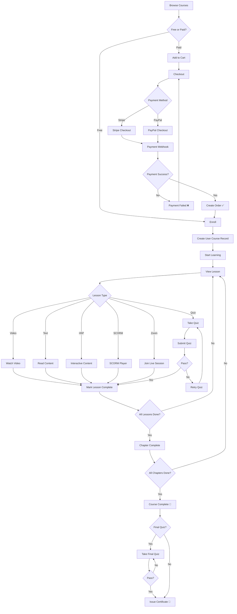

# Flow: Student Enrollment & Learning

## Key Decision Points

| Decision | Condition | Action |
|----------|-----------|--------|
| Free vs Paid | `course.field_price_type` | Free → direct enroll, Paid → checkout |
| Lesson completion | Depends on `lesson.field_type` | Video: 90% watched, Text: manual, Quiz: passed |
| Certificate issuance | Quiz passed + template linked | Auto-generate PDF + notify |
