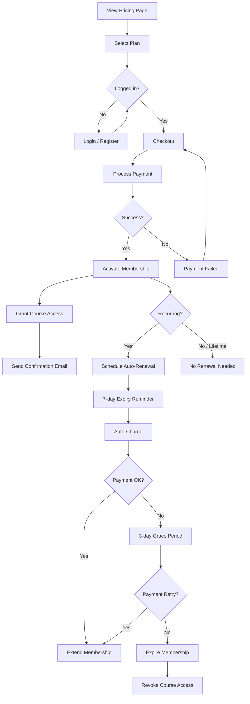

# Flow: Membership Subscription

## Subscription States

| State | Trigger | Actions |
|-------|---------|---------|
| `trial` | Plan has trial_days > 0 | Access granted, trial expiry scheduled |
| `active` | Payment success | Full access to plan courses |
| `expired` | End date passed + no renewal | Access revoked, notification sent |
| `cancelled` | User cancels | Access until period end, no renewal |
