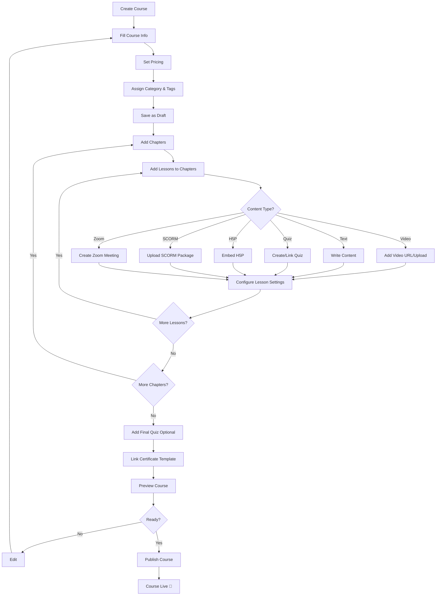
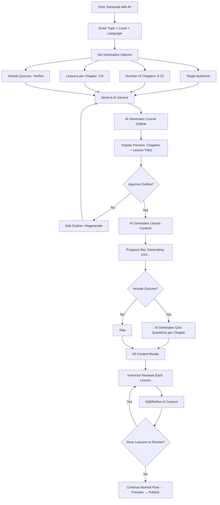

# Flow: Course Creation (Instructor/Admin)

## AI-Assisted Creation (Optional)

### AI Generation Capabilities
| Content | AI Action | Quality |
|---------|-----------|---------|
| Course outline | Generate chapter + lesson structure | High — well-organized |
| Lesson text | Generate rich text with headings, lists, code samples | Medium — needs review |
| Quiz questions | Generate MC/SC/TF questions per chapter | Medium — verify correctness |
| Course description | Generate SEO-optimized description | High |

> [!IMPORTANT]
> AI-generated content **luôn ở trạng thái Draft**. Instructor **bắt buộc** review và approve từng lesson trước khi publish.

