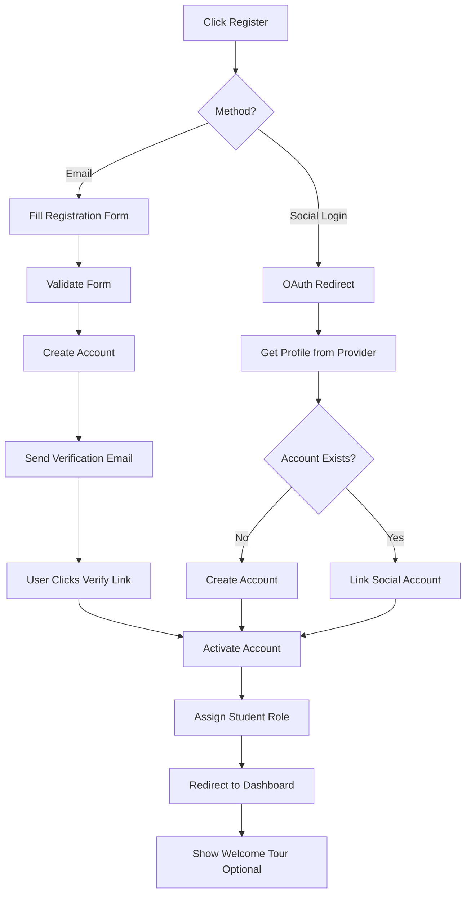

# Flow: User Registration

## Registration Fields

| Field | Required | Validation |
|-------|----------|-----------|
| Full Name | ✅ | Min 2 chars |
| Email | ✅ | Valid email, unique |
| Password | ✅ | Min 8 chars, 1 uppercase, 1 number |
| Confirm Password | ✅ | Must match |
| Terms & Conditions | ✅ | Must accept |
