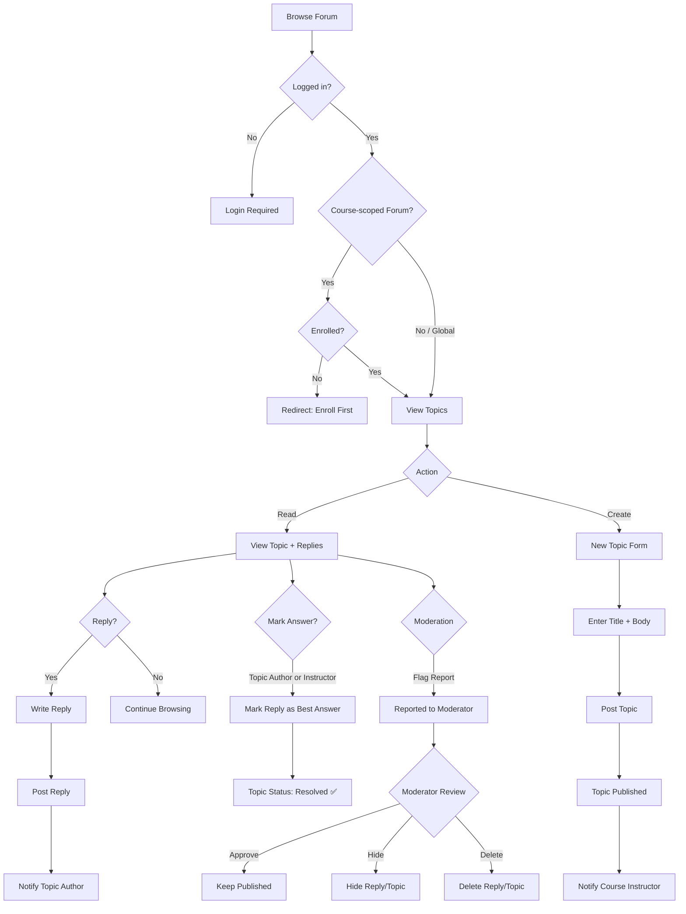

# Flow: Forum Discussion

## Key Business Rules
| Rule | Detail |
|------|--------|
| Course forum access | Only enrolled users + course instructor |
| Global forum access | All authenticated users |
| Pinned topics | Always display first, only admin/manager can pin |
| Locked topics | No new replies allowed |
| Best answer | Topic author or instructor can mark |
| Moderation | Flag → moderator queue → approve/hide/delete |
