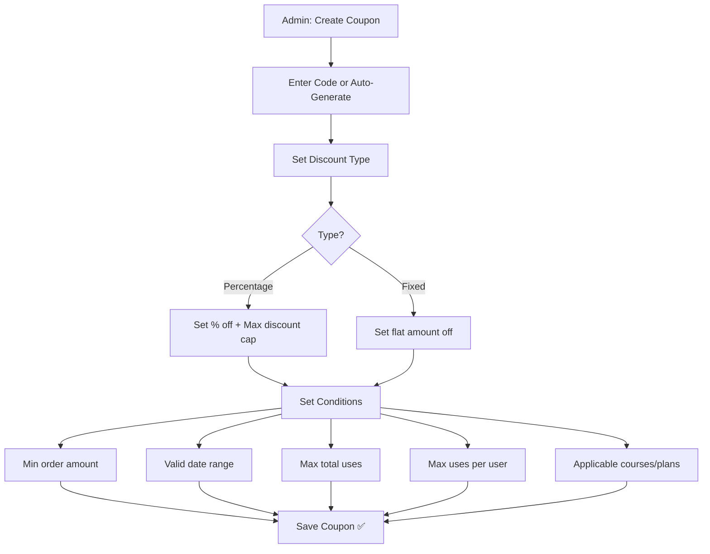
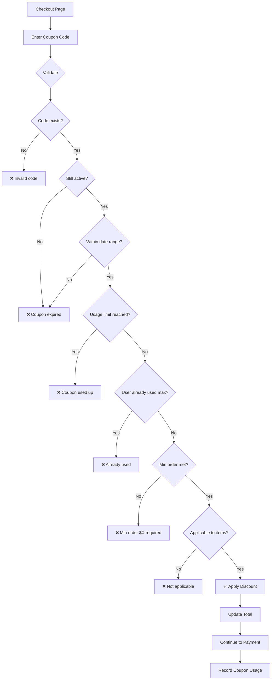

# Flow: Coupon Creation & Redemption

## Coupon Creation (Admin)

## Coupon Redemption (Student)

## Coupon Entity Quick Reference
| Field | Validation |
|-------|-----------|
| `field_code` | Unique, uppercase, alphanumeric |
| `field_discount_type` | `percentage` or `fixed` |
| `field_discount_value` | > 0, ≤ 100 for percentage |
| `field_max_discount` | Cap for percentage (nullable) |
| `field_min_order` | Min cart total (nullable) |
| `field_valid_from` | Start date (nullable) |
| `field_valid_until` | Expiry date (nullable) |
| `field_max_uses` | Total uses allowed (0 = unlimited) |
| `field_uses_per_user` | Per-user limit (0 = unlimited) |
| `field_applicable_courses` | Course references (empty = all) |
