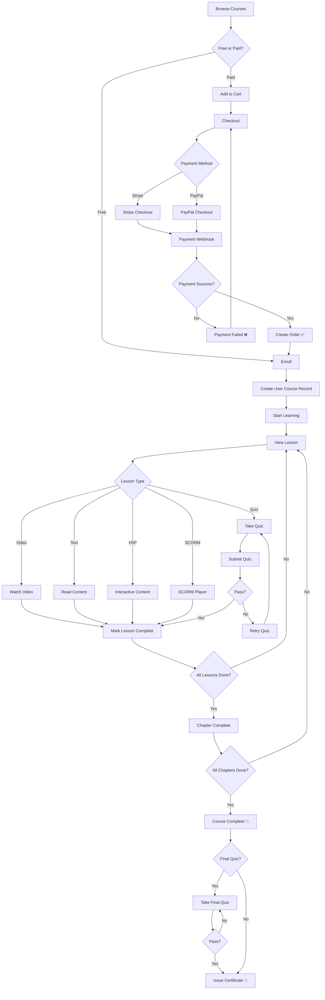
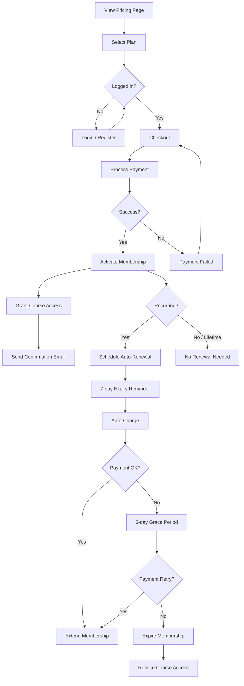
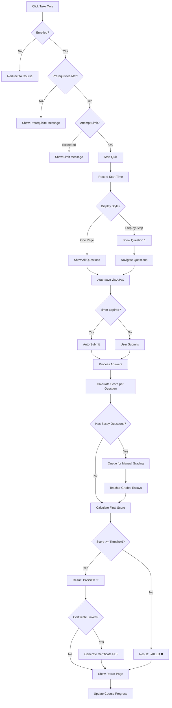
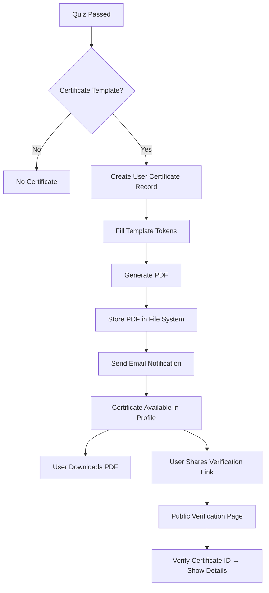
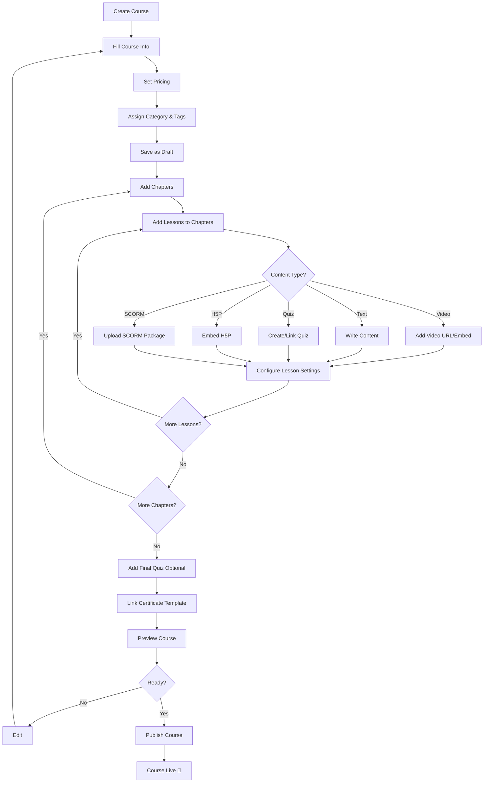
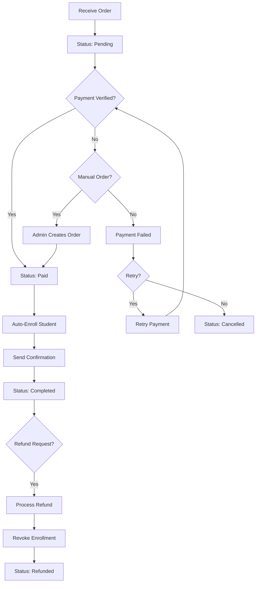
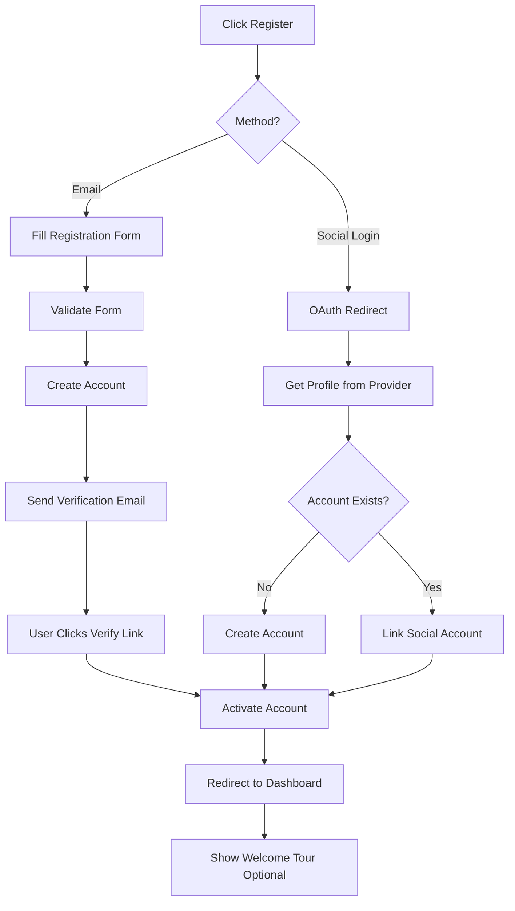

# EverLMS — Business Process Flows

## 1. Student Enrollment & Learning Flow

---

## 2. Membership Subscription Flow

---

## 3. Quiz Taking & Grading Flow

---

## 4. Certificate Issuance Flow

---

## 5. Course Creation Flow (Instructor/Admin)

---

## 6. Order Management Flow (Admin)

---

## 7. User Registration Flow

