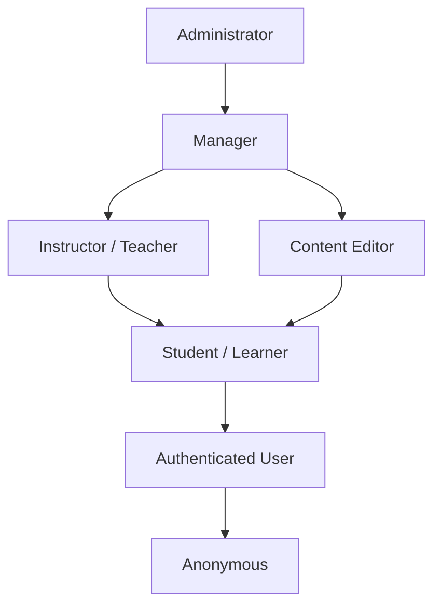

# EverLMS — Roles & Permissions

## 1. Role Hierarchy

---

## 2. Role Definitions

### R-01: Administrator
| Attribute | Value |
|-----------|-------|
| **Machine name** | `administrator` |
| **Scope** | Full system access |
| **Description** | Quản trị toàn quyền: settings, users, content, commerce, reports |

### R-02: Manager
| Attribute | Value |
|-----------|-------|
| **Machine name** | `manager` |
| **Scope** | Content + User management |
| **Description** | Quản lý nội dung, users, orders, reports. Không truy cập system settings |

### R-03: Instructor / Teacher
| Attribute | Value |
|-----------|-------|
| **Machine name** | `instructor` |
| **Scope** | Own courses + students |
| **Description** | Tạo/quản lý courses của mình, chấm bài, xem progress students |

### R-04: Content Editor
| Attribute | Value |
|-----------|-------|
| **Machine name** | `content_editor` |
| **Scope** | Content editing |
| **Description** | Biên tập nội dung courses/lessons, quản lý media. Không tạo courses mới |

### R-05: Student / Learner
| Attribute | Value |
|-----------|-------|
| **Machine name** | `student` |
| **Scope** | Learning + profile |
| **Description** | Enroll courses, learn, take quizzes, view certificates, participate forums |

### R-06: Authenticated User
| Attribute | Value |
|-----------|-------|
| **Machine name** | `authenticated` |
| **Scope** | Basic access |
| **Description** | Drupal default, browse courses, view profile |

### R-07: Anonymous
| Attribute | Value |
|-----------|-------|
| **Machine name** | `anonymous` |
| **Scope** | Public access |
| **Description** | Browse public pages, view course listings, register |

---

## 3. Permission Matrix

### Content Management
| Permission | Admin | Manager | Instructor | Editor | Student |
|-----------|-------|---------|-----------|--------|---------|
| Create course | ✅ | ✅ | ✅ | ❌ | ❌ |
| Edit any course | ✅ | ✅ | ❌ | ✅ | ❌ |
| Edit own course | ✅ | ✅ | ✅ | ✅ | ❌ |
| Delete course | ✅ | ✅ | ❌ | ❌ | ❌ |
| Publish course | ✅ | ✅ | ❌ | ❌ | ❌ |
| Create chapter | ✅ | ✅ | ✅ | ❌ | ❌ |
| Create lesson | ✅ | ✅ | ✅ | ✅ | ❌ |
| Manage media | ✅ | ✅ | ✅ | ✅ | ❌ |
| Manage categories | ✅ | ✅ | ❌ | ❌ | ❌ |

### Assessment
| Permission | Admin | Manager | Instructor | Editor | Student |
|-----------|-------|---------|-----------|--------|---------|
| Create quiz | ✅ | ✅ | ✅ | ❌ | ❌ |
| Manage questions | ✅ | ✅ | ✅ | ❌ | ❌ |
| Take quiz | ✅ | ✅ | ✅ | ❌ | ✅ |
| Grade quiz | ✅ | ✅ | ✅ (own) | ❌ | ❌ |
| View all results | ✅ | ✅ | ❌ | ❌ | ❌ |
| View own results | ✅ | ✅ | ✅ | ❌ | ✅ |
| Override score | ✅ | ✅ | ❌ | ❌ | ❌ |

### Commerce
| Permission | Admin | Manager | Instructor | Editor | Student |
|-----------|-------|---------|-----------|--------|---------|
| View all orders | ✅ | ✅ | ❌ | ❌ | ❌ |
| Manage orders | ✅ | ✅ | ❌ | ❌ | ❌ |
| Process refunds | ✅ | ❌ | ❌ | ❌ | ❌ |
| Manage memberships | ✅ | ✅ | ❌ | ❌ | ❌ |
| Manage coupons | ✅ | ✅ | ❌ | ❌ | ❌ |
| Purchase course | ✅ | ✅ | ✅ | ❌ | ✅ |
| View own orders | ✅ | ✅ | ✅ | ❌ | ✅ |

### Users & Reports
| Permission | Admin | Manager | Instructor | Editor | Student |
|-----------|-------|---------|-----------|--------|---------|
| Manage users | ✅ | ✅ | ❌ | ❌ | ❌ |
| Assign roles | ✅ | ❌ | ❌ | ❌ | ❌ |
| View reports | ✅ | ✅ | ✅ (own) | ❌ | ❌ |
| Export data | ✅ | ✅ | ❌ | ❌ | ❌ |
| System settings | ✅ | ❌ | ❌ | ❌ | ❌ |

### Certificate
| Permission | Admin | Manager | Instructor | Editor | Student |
|-----------|-------|---------|-----------|--------|---------|
| Manage templates | ✅ | ✅ | ❌ | ❌ | ❌ |
| Issue certificate | ✅ | ✅ | ✅ (own) | ❌ | ❌ |
| View all certificates | ✅ | ✅ | ✅ (own) | ❌ | ❌ |
| View own certificates | ✅ | ✅ | ✅ | ❌ | ✅ |
| Revoke certificate | ✅ | ✅ | ❌ | ❌ | ❌ |

### Communication
| Permission | Admin | Manager | Instructor | Editor | Student |
|-----------|-------|---------|-----------|--------|---------|
| Manage forum | ✅ | ✅ | ❌ | ❌ | ❌ |
| Create forum topic | ✅ | ✅ | ✅ | ❌ | ✅ |
| Reply forum | ✅ | ✅ | ✅ | ❌ | ✅ |
| Moderate comments | ✅ | ✅ | ✅ (own course) | ❌ | ❌ |
| Rate course | ✅ | ✅ | ✅ | ❌ | ✅ |
| Send notifications | ✅ | ✅ | ✅ (own students) | ❌ | ❌ |
| Manage FAQ | ✅ | ✅ | ✅ (own course) | ✅ | ❌ |

### Gamification
| Permission | Admin | Manager | Instructor | Editor | Student |
|-----------|-------|---------|-----------|--------|---------|
| Manage badges | ✅ | ✅ | ❌ | ❌ | ❌ |
| View badges | ✅ | ✅ | ✅ | ✅ | ✅ |
| View leaderboard | ✅ | ✅ | ✅ | ✅ | ✅ |
| Award badge manually | ✅ | ✅ | ❌ | ❌ | ❌ |

### Learning Path
| Permission | Admin | Manager | Instructor | Editor | Student |
|-----------|-------|---------|-----------|--------|---------|
| Create learning path | ✅ | ✅ | ✅ | ❌ | ❌ |
| Edit any learning path | ✅ | ✅ | ❌ | ✅ | ❌ |
| Edit own learning path | ✅ | ✅ | ✅ | ✅ | ❌ |
| Enroll in learning path | ✅ | ✅ | ✅ | ❌ | ✅ |
| View learning paths | ✅ | ✅ | ✅ | ✅ | ✅ |

### Blog & AI Configuration
| Permission | Admin | Manager | Instructor | Editor | Student |
|-----------|-------|---------|-----------|--------|---------|
| Administer AI / Blog settings | ✅ | ❌ | ❌ | ❌ | ❌ |
| Build Course via AI | ✅ | ✅ | ✅ | ❌ | ❌ |
| Generate Zoom Agenda / Summary | ✅ | ✅ | ✅ (own) | ❌ | ❌ |
| Generate Blog with AI | ✅ | ✅ | ✅ | ✅ | ❌ |
| Manage Any Blog Post | ✅ | ✅ | ❌ | ❌ | ❌ |
| Manage Own Blog Post | ✅ | ✅ | ✅ | ✅ | ❌ |
| Publish Blog Post | ✅ | ✅ | ❌ | ❌ | ❌ |

