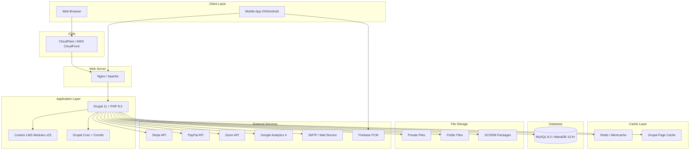
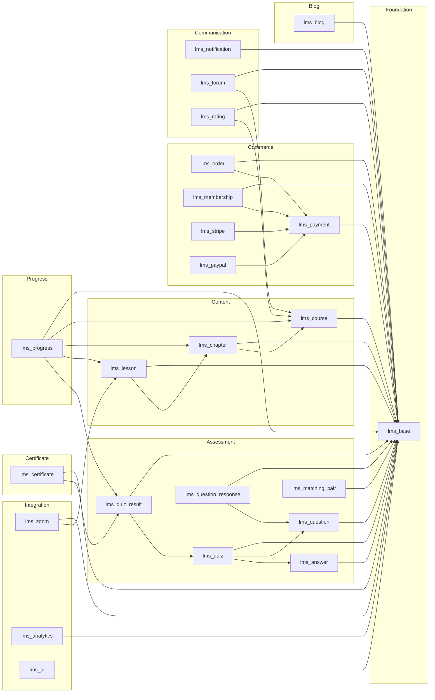
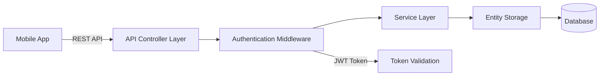

# EverLMS — System Architecture

## 1. Architecture Overview



---

## 2. Layered Architecture

| Layer | Responsibility | Components |
|-------|---------------|-----------|
| **Presentation** | UI rendering, templates | Twig templates, SCSS, JS (Drupal behaviors) |
| **Controller** | Request handling, routing | Controllers (Data prep only → Twig) |
| **Service** | Business logic | Manager services, handlers |
| **Data** | Entity CRUD, storage | Entity types, Field storage, Database API |
| **Integration** | External APIs | Gateway plugins, API clients |
| **Infrastructure** | Hosting, caching | Web server, PHP, DB, Redis, CDN |

---

## 3. Module Dependency Graph



---

## 4. Design Patterns

### 4.1 Strategy Pattern — Question Handler
```
QuestionHandlerInterface
├── MultipleChoiceHandler
├── SingleChoiceHandler
├── TrueFalseHandler
├── FillBlankHandler
├── ShortAnswerHandler
├── MatchingHandler
├── OrderingHandler
└── EssayHandler
```
- **Manager**: `lms_question.handler_manager` → resolves handler by question bundle.
- **Responsibilities**: `buildFormElement()`, `prepareResponseData()`, `calculateScore()`.

### 4.2 Plugin Pattern — Payment Gateway
```
PaymentGatewayInterface
├── StripeGateway
├── PaypalGateway
└── (Future gateways)
```
- **Manager**: `lms_payment.gateway_manager` → resolves gateway by config.

### 4.3 Event-Driven — Notifications
```
Events:
├── CourseEnrolledEvent → Send welcome email
├── QuizCompletedEvent → Send result notification
├── CertificateIssuedEvent → Send certificate email
├── PaymentReceivedEvent → Send receipt
└── MembershipExpiringEvent → Send reminder
```

### 4.4 Twig-First Rendering
- **Controller**: Prepares View Model (data arrays) → passes to `#theme`.
- **Twig**: Handles ALL HTML structure, CSS classes, layout.
- **No HTML in Controller**: Tuyệt đối không build HTML trong PHP.

---

## 5. API Architecture (for Mobile App)



| Component | Technology |
|-----------|-----------|
| API Format | JSON:API / REST |
| Authentication | OAuth2 / JWT |
| Rate Limiting | Drupal + Nginx |
| API Docs | OpenAPI 3.0 / Swagger |
| Versioning | URL prefix `/api/v1/` |

---

## 6. Infrastructure Requirements

### 6.1 Development
| Component | Version |
|-----------|---------|
| PHP | 8.3+ |
| Drupal | 11.x |
| MySQL | 8.0+ / MariaDB 10.6+ |
| Node.js | 20 LTS (SCSS build) |
| Composer | 2.x |
| DDEV | Latest |

### 6.2 Production
| Component | Recommendation |
|-----------|---------------|
| Web Server | Nginx 1.24+ |
| PHP-FPM | PHP 8.3, OPcache |
| Database | MySQL 8.0 (managed) |
| Cache | Redis 7+ |
| CDN | CloudFlare / AWS CloudFront |
| SSL | Let's Encrypt / managed cert |
| Storage | S3-compatible (private/public files) |
| Search | Drupal Search API + Solr (optional) |
| Monitoring | New Relic / Datadog |
| CI/CD | GitHub Actions / GitLab CI |
